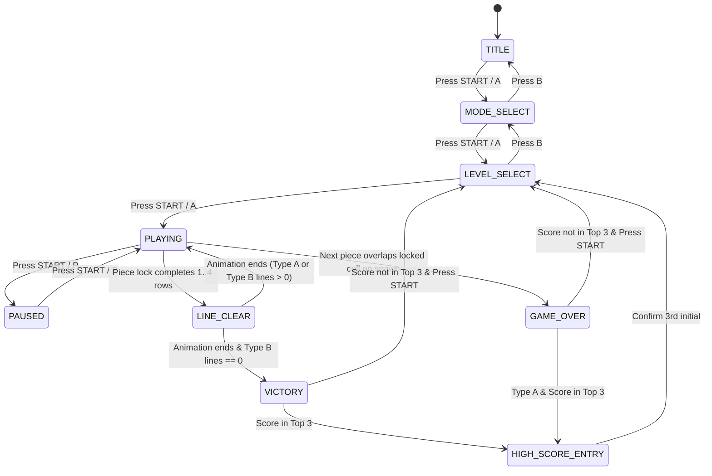

# Phase 1 Data Model: Game Boy Tetris (1989) Recreation

**Feature**: `001-tetris-gb-game`  
**Date**: 2026-10-25

## 1. Enumerations & Constants

### `TetrominoType`
- Values: `'L' | 'J' | 'I' | 'O' | 'Z' | 'S' | 'T'`
- Each type maps to:
  - 4 rotation matrices (`0` = 0°, `1` = 90° CW, `2` = 180°, `3` = 270° CW) on a `4×4` local grid.
  - A distinct tile visual style matching `tetris_gb/screenshot_01.png`–`screenshot_13.png` (including connected end/mid tiles for `'I'` when active, and individual tile patterns when locked).

### `CellValue`
- Values: `0` (empty) | `'L' | 'J' | 'I' | 'O' | 'Z' | 'S' | 'T' | 'GARBAGE' | 'CURTAIN'`

### `GameType` & `MusicType`
- `GameType`: `'A' | 'B'`
- `MusicType`: `'A' | 'B' | 'C' | 'OFF'`

### `ScreenState`
- Values:
  - `'TITLE'`: Title screen (`screenshot_00.png`)
  - `'MODE_SELECT'`: Game Type (`A-TYPE` / `B-TYPE`) & Music Type (`A-TYPE` / `B-TYPE` / `C-TYPE` / `OFF`) menu
  - `'LEVEL_SELECT'`: Level (`0`–`9`), Height (`0`–`5` in B-Type), and Top-3 High Score display
  - `'PLAYING'`: Active falling-piece gameplay (`screenshot_01.png`–`screenshot_13.png`)
  - `'LINE_CLEAR'`: Brief line-clear blink/collapse animation (`~45` frames)
  - `'PAUSED'`: Pause screen masking the well and next piece
  - `'VICTORY'`: Type B 25-line clear celebration and bonus tally screen
  - `'GAME_OVER'`: Curtain animation followed by `GAME OVER / PLEASE TRY AGAIN ♥`
  - `'HIGH_SCORE_ENTRY'`: 3-character initials entry when score qualifies for Top 3

## 2. Core Entities

### `WellGrid`
- **Dimensions**: `20` rows (`0`..`19` from top to bottom) × `10` columns (`0`..`9` from left to right).
- **Viewport Mapping**:
  - Rows `0`–`1`: Hidden upper buffer rows.
  - Rows `2`–`19`: The `18` visible rows inside the brick walls on the `160×144` screen.
- **Invariants**:
  - Every cell contains a valid `CellValue`.
  - In Type B initialization, the bottom `H` rows (`H ∈ {0, 3, 5, 8, 10, 12}` for `height ∈ 0..5`) contain at least 1 empty cell (`0`) and 1 occupied cell per row so no pre-filled row starts already complete.

### `ActivePiece`
- `type`: `TetrominoType`
- `rotation`: `0 | 1 | 2 | 3`
- `row`: `number` (top-left of 4×4 matrix; spawns so the piece center aligns with column 4, visible top row 2)
- `col`: `number`
- `gravityTimer`: `number` (frames elapsed since last gravity step)
- `softDropCounter`: `number` (continuous rows soft-dropped during current piece descent)
- `softDropFrameTimer`: `number` (frames elapsed in current 3-frame soft-drop step)

### `DASState` (Delayed Auto-Shift)
- `direction`: `'LEFT' | 'RIGHT' | null`
- `framesHeld`: `number` (initial movement on frame 0, then at frame 23, then every 9 frames)

### `GameConfig`
- `gameType`: `'A' | 'B'`
- `musicType`: `'A' | 'B' | 'C' | 'OFF'`
- `startLevel`: `number` (`0`..`9`)
- `startHeight`: `number` (`0`..`5`, used only when `gameType === 'B'`)

### `HighScoreEntry` & `HighScoreStore`
- `HighScoreEntry`:
  - `name`: `string` (up to 6 characters, default 3-letter arcade entry `'AAA'`..`'ZZZ'`)
  - `score`: `number` (`0`..`999999`)
- `HighScoreStore`:
  - Keyed by `${gameType}-L${startLevel}-H${gameType === 'B' ? startHeight : 0}`
  - Holds up to 3 `HighScoreEntry` records sorted descending by `score`.

### `GameState`
- `screen`: `ScreenState`
- `config`: `GameConfig`
- `well`: `CellValue[][]` (`20×10`)
- `activePiece`: `ActivePiece | null`
- `nextPiece`: `TetrominoType`
- `showNextPreview`: `boolean`
- `score`: `number` (`0`..`999999`)
- `level`: `number` (`0`..`20`)
- `lines`: `number` (in Type A: total lines cleared `0`..`999`; in Type B: lines remaining `25`..`0`)
- `totalLinesCleared`: `number`
- `clearingRows`: `number[]` (row indices currently animating during `'LINE_CLEAR'`)
- `animationTimer`: `number` (frame counter for line-clear blink, curtain fill, or victory sequence)
- `das`: `DASState`
- `highScores`: `Record<string, HighScoreEntry[]>`
- `enteringName`: `{ chars: [number, number, number]; cursorIndex: number; rank: number } | null`
- `paletteMode`: `'SCREENSHOT' | 'DMG_CLASSIC'`

## 3. State Transition Rules

